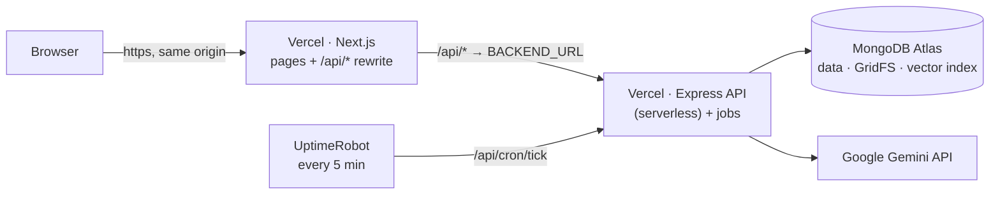

# Deployment

## Live deployment

| | |
|---|---|
| **Application** | **https://ai-companion-two-jet.vercel.app** |
| Frontend | Vercel (Next.js 16), project Root Directory `frontend` |
| API + background jobs | Vercel (Express 5 as one serverless function), project Root Directory `backend`. Jobs run as soon as they are queued; UptimeRobot triggers the scheduled maintenance every 5 minutes |
| Database and file storage | MongoDB Atlas (documents, GridFS for PDFs, Atlas Vector Search) |
| AI | Google Gemini API |
| Health (through the app's origin) | [`/api/health`](https://ai-companion-two-jet.vercel.app/api/health) (liveness) · [`/api/health/ready`](https://ai-companion-two-jet.vercel.app/api/health/ready) (database round trip) |

Learners can register on the site. For the demo, the admin login is shown in the [README](../README.md#demo-admin-login) and on the sign-in page.

The browser only talks to the frontend's origin, and `/api/*` is reverse-proxied to the API project. The session cookie is therefore first-party and httpOnly,
and no CORS setup is needed ([ARCHITECTURE.md D1](ARCHITECTURE.md#32-key-decisions-simplifications--future-work)).

---

## 1. MongoDB Atlas

1. Create a cluster (MongoDB 7+; the free M0 tier works for the prototype) and a database user.
2. **Network Access**: allow the API host. Vercel functions have no fixed outbound addresses, so allow `0.0.0.0/0` with a strong database password.
3. Copy the connection string into `MONGODB_URI`. If the password contains `#` or other special characters, URL-encode it.

No manual index setup is needed. Mongoose builds the collection indexes on start, and the API requests the **Atlas Vector Search index** `chunks_vector` (768 dimensions, cosine, filtered by `projectId` / `ownerId` / `materialId`). While that index builds, or if Atlas Search is unavailable, retrieval uses the in-process fallback automatically. **Admin → System health** shows the current retrieval mode.

## 2. API on Vercel

Import the repository as a second Vercel project with **Root Directory** `backend`. [`backend/vercel.json`](../backend/vercel.json) pins the Express preset and `npm run build` (tsup), and [`backend/app.js`](../backend/app.js) serves the bundle [`src/vercel.ts`](../backend/src/vercel.ts) builds. Vercel's own TypeScript compiler is never used, because the sources import without file extensions.

There is no long-running process on Vercel, so `src/vercel.ts` replaces the polling worker:

- The database connects on the first request and is reused while the function instance lives. The admin account and the vector index are checked once per instance.
- A job starts as soon as a request queues it (an upload, a tutor answer's follow-ups, a quiz grading). `waitUntil` keeps the function alive until it finishes, within Vercel's 300 s limit. New jobs are only claimed while there is time left. If a long job is still running when the function ends, its lease expires and the next maintenance run requeues it. Material processing is checkpointed per stage, so the retry continues where it stopped.
- **UptimeRobot** calls `GET /api/cron/tick?key=<CRON_KEY>` every 5 minutes (a free *Keyword* monitor on `"ok":true`). This runs the maintenance the worker schedules every minute elsewhere (`system.reconcile`: stale leases, stuck materials, interrupted answers, quiz grading), then any job still due, such as retries.

**Environment variables** (template: [`backend/.env.example`](../backend/.env.example)):

| Variable | Production value |
|---|---|
| `NODE_ENV` | `production` |
| `MONGODB_URI` · `MONGODB_DB_NAME` | Atlas connection string · database name |
| `JWT_SECRET` | 48+ random bytes, e.g. `node -e "console.log(require('crypto').randomBytes(48).toString('base64url'))"` |
| `COOKIE_SECURE` | `true` (HTTPS) |
| `TRUST_PROXY` | `1` (client IPs for rate limits) |
| `ADMIN_EMAIL` · `ADMIN_PASSWORD` · `ADMIN_NAME` | the admin account created on first boot |
| `GEMINI_API_KEY` | Gemini API key |
| `MAX_UPLOAD_MB` | `4`: Vercel rejects request bodies over 4.5 MB before they reach the API (the upload panel mirrors it) |
| `CRON_KEY` | a long random string; part of the UptimeRobot URL |
| Optional | `AI_MODEL_*` (model chains), `RETRIEVAL_*` (evidence thresholds), `*_JUDGE_SAMPLE_RATE`, `WORKER_CONCURRENCY` (job slots per run), `LOG_LEVEL`; defaults are documented in [ARCHITECTURE.md §30](ARCHITECTURE.md#30-configuration--deployment) |

`PORT`, `APP_ROLE` and `WORKER_POLL_MS` are not used on Vercel. `CORS_ORIGINS` is only needed if a browser calls the API origin directly, which this setup never does.

On any long-running Node host, the same code runs the classic way: `npm run build`, then `npm start` (API and polling worker in one process, `APP_ROLE=all`).

**Resetting the admin password**: change `ADMIN_PASSWORD`, then run `npm run seed:admin` from a shell with the same environment. This also signs out existing admin sessions.

## 3. Frontend on Vercel

1. Import the repository and set **Root Directory** to `frontend`. [`frontend/vercel.json`](../frontend/vercel.json) pins the framework, `npm ci` and `npm run build`, and adds security headers to every page: `X-Content-Type-Options`, `X-Frame-Options: SAMEORIGIN`, `Referrer-Policy` and `Permissions-Policy`. `/api/*` is excluded because the API sets its own headers.
2. Environment variable **`BACKEND_URL`** = the API project's production origin, e.g. `https://<api-project>.vercel.app`, with no trailing slash.
3. Deploy. `BACKEND_URL` is read **at build time** by the `/api/*` rewrite, so **redeploy after changing it**.

## 4. Smoke test after a deploy

1. `GET /api/health` returns `{"status":"ok"}` and `GET /api/health/ready` returns `"database":{"status":"up"}`. `GET /api/cron/tick?key=<CRON_KEY>` on the API origin returns `{"ok":true}`.
2. Register a learner, create a Space and a Project, and upload a PDF (up to 4 MB). The material should move from *Queued* to *Processing* to *Ready*.
3. Ask Zoya a question the PDF answers (a cited answer), then one it doesn't (the "not in your materials" reply).
4. Take a short quiz with a written answer; check that Growth, Analytics and Home show progress and a recommendation.
5. Sign in as the admin and check **System health** (database, storage, AI gateway, worker, retrieval mode), **Background jobs** and **AI usage**. The worker named `vercel` shows when jobs last ran.

## Troubleshooting

| Symptom | Likely cause |
|---|---|
| `/api/*` returns 502/504 | `BACKEND_URL` is wrong. Check `/api/health` on the API origin, then redeploy the frontend after fixing the variable |
| Every API request fails with `FUNCTION_INVOCATION_FAILED` | The function crashed at start. A missing or invalid environment variable is listed in the API project's **Logs**. Redeploy after changing variables |
| Login works but the session is lost | `COOKIE_SECURE=true` requires HTTPS, which both hosts provide. Also check that the browser uses the frontend's origin, not the API's |
| API fails to start with a database timeout or TLS alert | The Atlas Network Access list doesn't include the host |
| Upload fails with 413 | The PDF is over 4 MB, Vercel's request limit. Split or compress it |
| Materials stay *Queued* or a retry never runs | Check the UptimeRobot monitor and `GET /api/cron/tick`. **Background jobs** shows the queue |
| Tutor answers are slow or say the AI is busy | Free-tier Gemini 429/503 errors; the gateway falls back automatically. **AI usage** shows the errors and fallbacks per model |
| Retrieval mode shows *memory* or *lexical* | The vector index is still building or unavailable; answers keep working through the fallback |

## Secrets policy

Real values live only in the hosts' dashboards and in local, git-ignored `.env` files. The repository contains placeholders only
(`backend/.env.example`, `frontend/.env.example`). The one deliberate exception is the **demo admin login**, published for reviewers.
Its password is not used anywhere else and should be rotated after the review: set a new `ADMIN_PASSWORD` in the API project on Vercel, run `npm run seed:admin`,
then update the README and `frontend/src/lib/demo.ts`.
